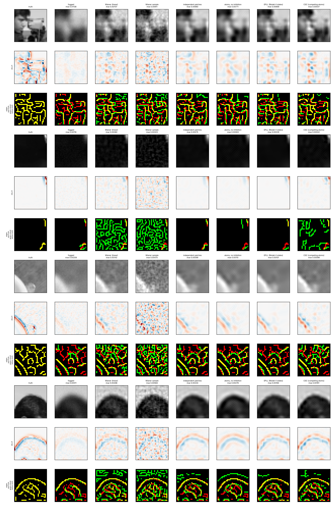

# Sihtiimagemodel6 — seeing back through the fog

**Model 2's detail stage, tested on its own: put back the residue bands the Sihti sieve removed,
using local atoms that compete for one shared picture.**
CPU only. No transformer, no pretrained network, no labels; the clean image never reaches a method.

Model 2 found two ways to fail at fine detail: predict the *average* detail (too smooth, 0.115× the
real fine-band energy) or *sample* it independently (grainy, 1.59×). Model 4 found that the states
that help natural images are local edge states. The Nov 1 conversation (Antti, Astra, Claude) asked
whether the missing ingredient is **coordination**: atoms that compete for one reconstruction, so
neighbouring choices must agree. That is convolutional sparse coding (the objective Rozell's LCA
solves with neural dynamics; lateral inhibition = overlap of fogged footprints).

Preregistration: [docs/PREREG.md](docs/PREREG.md), including **Amendment 1**, all committed and
pushed before the test was run. Parameters were tuned on validation only, in five logged stages
(`params.json → tune_log`), and frozen in `fe21011` before the test.

## The fog — and a correction found before the test

The observation is the Sihti core: `y = purify^8(x) + N(0, 0.01²)`, using Sihti's own diffusion step.
**Astra found that this "fog" is not a blur.** At dt = 0.25, `purify` replaces each pixel by the mean
of its four neighbours, so each step multiplies the frequency mode (kx, ky) by (cos kx + cos ky)/2.
Eight steps kill the *middle* frequencies but pass the **checkerboard corner**: the highest 32×32
mode keeps 96% of its amplitude, flipping sign every step. It is a band-stop. This is now a test
(`test_the_two_fogs`). It also corrects how the whole Sihti line has been described: its "purification"
is a low-pass only for the low half of the spectrum.

So the experiment runs on **two fogs** with the same gates:

* **Sihti fog** — `purify^8` exactly as the Sihti line uses it (preregistered primary);
* **heat fog** — the same Laplacian over the same time (2) in 32 steps of 1/16: a true low-pass.
  Every arm was re-tuned for it on validation.

## Arms (each gets the same observation y)

| Arm | What it is |
|---|---|
| `wiener` | exact LMMSE under a full-image Gaussian (Ledoit-Wolf): the best *linear* focus, a set of per-mode attenuations |
| `wiener_sample` | a sample of the same posterior: Model 2's "sampled residue" |
| `independent` | 64 learned 8×8 atoms; every overlapping patch sparse-codes its own fogged pixels alone, then averaged |
| `no_inhibition` | **the tight control**: the same atoms, full operator and smooth core as `csc`; every atom fits the core's residual alone (LCA with the inhibition term deleted) |
| `epll` | Model 4's engine on this fog: 20-state patch GMM, hard state per patch (EPLL schedule) |
| `csc` | the same atoms at every position, **competing** for one reconstruction under the true fog, plus a smooth core whose detail is penalised (FISTA, 400 iterations) |
| `csc_converged` | report only: the same objective at 1600 iterations |

## Results (64 test crops of three photographs never used in training or tuning)

**Sihti fog** (`results/natural/metrics.json`)

| Arm | MSE | edge F | orientation error | fine-band ratio | flicker (24 pans) |
|---|---:|---:|---:|---:|---:|
| fogged | 0.00390 | 0.754 | 12.4° | 0.14 | — |
| Wiener | 0.00247 | 0.671 | 8.1° | 0.47 | 0.0214 |
| Wiener sample | 0.00493 | 0.643 | 10.7° | **1.52** | 0.0492 |
| independent patches | 0.00223 | **0.829** | 8.3° | 0.26 | 0.0085 |
| atoms, no inhibition | 0.00250 | 0.810 | 9.1° | 0.32 | 0.0090 |
| EPLL (Model 4 states) | 0.00200 | 0.825 | 7.7° | 0.24 | **0.0081** |
| **CSC (competing atoms)** | **0.00183** | 0.786 | **7.2°** | 0.45 | 0.0145 |
| CSC, converged *(report only)* | 0.00213 | 0.755 | 7.5° | 0.53 | — |

**Heat fog** (gated replication, own validation tuning)

| Arm | MSE | edge F | orientation error | fine-band ratio |
|---|---:|---:|---:|---:|
| Wiener | 0.00228 | 0.673 | 7.4° | 0.47 |
| Wiener sample | 0.00463 | 0.643 | 9.6° | 1.57 |
| independent patches | 0.00202 | 0.800 | 7.0° | 0.37 |
| atoms, no inhibition | 0.00197 | 0.772 | 7.4° | 0.25 |
| EPLL | 0.00183 | **0.839** | 7.1° | 0.26 |
| **CSC** | **0.00163** | 0.764 | **6.5°** | 0.38 |

### Gates

| Gate | Sihti fog | Heat fog |
|---|---|---|
| **G1** focus beyond linear (MSE ≤ 0.95× Wiener, CI < 1, edge-F higher) | **PASS** 0.74 (CI 0.71–0.77) | **PASS** 0.71 (0.68–0.74) |
| **G2** beats independent patches (≤ 0.95, CI < 1, orientation better) | **PASS** 0.82 (0.79–0.85) | **PASS** 0.81 (0.77–0.85) |
| **G2b** competition itself pays (≤ 0.95× no-inhibition, CI < 1, **and** edge-F higher) | **FAIL** — MSE 0.73 (0.71–0.76) passes, edge-F 0.786 < 0.810 | **FAIL** — MSE 0.83 (0.80–0.86) passes, edge-F 0.764 < 0.772 |
| **G3** beats Model 4's engine (≤ 0.97× EPLL, CI < 1) | **PASS** 0.91 (0.88–0.95) | **PASS** 0.89 (0.86–0.94) |
| **G4** temporal (flicker ≤ 1.25× Wiener **and** ≤ independent) | **FAIL** — 0.0145 < 0.0267, but > 0.0085 (worse in **24/24** pans) | — |
| **G5** *instrument:* right energy, wrong places | **PASS** — band ratio 1.52, MSE 2× Wiener, edge-F below CSC | — |



## What this says — honestly

**What held, on both fogs.** Competing atoms see back through the fog better than any other arm
here by pixel error and edge orientation: 26–29% below the best linear filter, 18–19% below
independent patches, 9–11% below Model 4's state engine. Removing *only* the competition
(same atoms, operator, core) costs 21–37% in MSE. The MSE half of "coordination is what pays"
passes by a wide margin with tight intervals on both fogs.

**What failed, and why (post-hoc, [`posthoc.py`](posthoc.py), `results/natural/posthoc_edges.json`).**
Splitting edge-F into its two halves:

| Sihti fog | precision | recall | spurious-edge rate in flat regions |
|---|---:|---:|---:|
| Wiener | 0.52 | 0.93 | 24% |
| independent | 0.85 | 0.81 | 4.9% |
| no inhibition | 0.81 | 0.81 | 6.4% |
| EPLL | **0.89** | 0.77 | **4.4%** |
| CSC | 0.71 | **0.89** | 10.1% |

CSC finds more of the true edges than any non-linear arm, and puts them in the right direction,
but it also writes faint atoms into **flat** regions, where the fog left nothing but noise. Canny
reads that texture as edges, and so precision drops. The same faint, noise-driven atoms change from
frame to frame. That is G4: CSC is calmer than Wiener but flickers more than every conservative arm,
in every pan. **Coordination fixes the blur-versus-grain dilemma where there is structure, but it
does not know when to stay silent where there is none.** EPLL is the mirror image: conservative,
precise, and it misses edges. The heat fog shows the same split (CSC precision 0.66, recall 0.91;
EPLL 0.91 / 0.78), so it is not an artefact of the band-stop.

**Early stopping is part of the win (disclosed in Amendment 1).** Run to near-convergence, the same
objective scores 0.00213, which is still well ahead of Wiener but *behind* EPLL (0.00200). So **G3 passes
for the validated 400-iteration solver, not for the objective's optimum.** Stopping early leaves
coefficients small, which acts as extra shrinkage. A claim about "the sparse-coding objective beats
Model 4" would be false.

**G5 (instrument) reproduces Model 2's failure exactly.** The posterior sample has 1.52× the true
fine-band energy (Model 2: 1.59×), twice the Wiener error, and the worst edges. The right *amount* of
detail in the wrong places; Astra's point that fine-band energy is not a success measure, shown.

**On the fog itself.** At depth 16 (report only), every arm degrades and the ranking holds
(CSC 0.00289, EPLL 0.00301, Wiener 0.00341), but independent patches and no-inhibition fall *below*
Wiener there.

### Caveats

* 32×32 grey crops of three test photographs; the noise level is known to every method.
* `no_inhibition` is a weak method by construction (it ends up close to "smooth core alone");
  its choice sat on grid edges until stage 5 of tuning, and on the heat fog its λ is on the low edge of a
  very shallow valley (recorded in `params.json`).
* The temporal test reconstructs every frame on its own. It measures consistency, not memory.
* Prior art: convolutional sparse coding (Zeiler et al. 2010; Bristow, Eriksson & Lucey 2013),
  LCA (Rozell et al. 2008), sparse-representation super-resolution (Yang et al. 2010), EPLL (Zoran &
  Weiss 2011). What is tested here is the coordination claim under controls, not a new method.

## Next, if it earns one

The failure says what is missing, and it is the same thing twice: **a reason to stay silent**. In space,
an atom should not fire where the fog left only noise. In time, it should not re-decide each frame
from scratch. Model 5's living paper already carries a per-pixel precision and checks history against
the present. Putting Model 6's competing atoms inside Model 5's paper (prediction, then correction
weighted by confidence) is the experiment that would test whether memory supplies the
missing silence. That is the bridge Astra wrote down: `z_t = P z_{t-1} + K (y − H P z_{t-1})`.

## Run it

```bash
pip install -r requirements.txt pytest
python -m pytest -q                 # 11 tests: Sihti operator, both fogs, adjoints, descent, controls, no leak
python tune.py && python tune_extend.py && python tune_amend.py && python tune_edges.py && python tune_noinh_corner.py
                                    # validation only -> params.json (about 50 min on 2 cores)
python run6.py                      # the preregistered test -> results/natural/ (about 15 min)
python posthoc.py                   # edge precision / recall / flat-region diagnostic
python run6.py --train-folder train --eval-folder unseen --eval-limit 32 --name things
                                    # your own photographs (32x32 grey, not a gate run)
```

| File | What |
|---|---|
| `fog.py` | Sihti's `purify`, the dense fog operator, the two fogs |
| `models.py` | Wiener, posterior sample, independent patches, CSC (+ no-inhibition control), EPLL |
| `metrics.py` | MSE, edge position F, orientation error, fine-band ratio |
| `bench.py` | shared fitting, arms, camera pans, flicker |
| `run6.py`, `figures.py` | test, gates, figures |
| `tune*.py`, `params.json` | the five validation stages and their full log |
| `posthoc.py` | the post-hoc diagnosis above |
| `data.py` | vendored unchanged from Model 4 |
